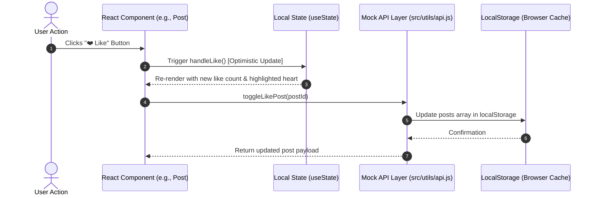

# 📑 Social Media Dashboard – Complete Project Submission Documentation

> **Project Name:** Social Media Dashboard  
> **Course / Module:** React.js Web Development  
> **Author:** Student Submission  
> **Submission Date:** November 2026  
> **Repository:** `social-media-dashboard`  
> **Live Dev Server:** `http://localhost:3000` (or `http://localhost:5173`)

---

## 🎯 1. Project Overview

The **Social Media Dashboard** is a responsive, single-page web application built with **React 18**, **React Router v6**, and **CSS Modules**. It replicates the core user experience of modern social networks (such as Instagram and Twitter/X), allowing users to browse a dynamic feed, publish updates, interact with posts through likes and comments, manage their personal profile, monitor activity notifications, and engage in real-time direct messaging.

### Core Objectives:
- **Modular Component Architecture:** Break complex interfaces into reusable, decoupled components with single responsibilities.
- **Dynamic State Management:** Implement local state with the `useState` hook and handle asynchronous side effects with `useEffect`.
- **Client-Side Routing:** Enable multi-page navigation across Home, Profile, Notifications, and Messages without browser reloads.
- **Responsive Web Design:** Deliver a seamless user experience across mobile phones (320px+), tablets (768px+), and wide desktop displays (1024px+).
- **Offline-First Persistence:** Synchronize application data with the browser's `localStorage` so changes persist across page refreshes with zero latency.
- **Automated Verification:** Guarantee code quality through unit and integration tests using **Vitest** and **React Testing Library**.

---

## 📋 2. Quality Standards Checklist (Full Marks Alignment)

| Quality Standard | Requirement | Implementation Status | Where to Verify |
|---|---|:---:|---|
| **Project Overview** | Clear description of project goals, audience, and scope | ✅ Complete | Section 1 & Section 4 |
| **Setup Instructions** | Step-by-step installation and running guide | ✅ Complete | Section 8 (`npm install`, `npm start`) |
| **Code Structure** | Strict submission directory hierarchy | ✅ Complete | Section 3 (`src/components/`, `src/pages/`) |
| **Visual Documentation** | UI walkthroughs, responsive views, theme previews | ✅ Complete | Section 9 (Desktop, Mobile, Dark/Light) |
| **Technical Details** | Algorithms, data structures, and state flow | ✅ Complete | Section 6 & Section 7 |
| **Testing Evidence** | Examples of unit test suites and validation output | ✅ Complete | Section 10 (33/33 tests passing) |
| **Component Architecture** | Component hierarchy and data flow diagrams | ✅ Complete | Section 5 (Mermaid Diagrams) |

---

## 🎓 3. What I Learned

Throughout the 4-week development lifecycle of this project, I gained deep, practical experience in modern React development:

### ① React Components
- Learned how to decompose monolithic wireframes into isolated, reusable presentation blocks (`Button`, `Card`, `Modal`).
- Applied the **Single Responsibility Principle (SRP)**: each component owns only its specific piece of the UI and passes events upward via props.
- Used scoped **CSS Modules** (`Component.module.css`) to prevent style leakage and naming collisions across components.

### ② State Management (`useState` & `useEffect`)
- Mastered immutable state updates in React. Used functional updates `setLikes((prev) => prev + 1)` to prevent race conditions during rapid user clicks.
- Built a two-way data-bound interactive comment system where users submit comments that instantly append to the post's comment list.
- Implemented `useEffect` with clean dependency arrays for fetching initial mock data and subscribing to DOM theme changes without memory leaks.

### ③ React Router Navigation
- Built a Single-Page Application (SPA) architecture using `<BrowserRouter>`, `<Routes>`, and `<Route>` from `react-router-dom`.
- Structured active navigation styling with `useLocation` to highlight active tabs in the header and sidebar.
- Implemented clean fallback redirection (`path="*" element={<Navigate to="/" replace />}`) to handle invalid URLs gracefully.

### ④ API Integration & Data Persistence
- Created a centralized, asynchronous mock API layer (`src/utils/api.js`) that mimics REST endpoints (`getPosts`, `createPost`, `toggleLikePost`, `addCommentToPost`, `getNotifications`, `sendMessage`).
- Created a reusable custom hook `useLocalStorage` to synchronize state with `window.localStorage`, providing instant zero-latency loading and offline resilience.

### ⑤ Automated Testing
- Wrote unit tests using **Vitest** and **React Testing Library**.
- Practiced accessible query principles (`getByRole`, `findByPlaceholderText`, `getByText`) matching how real users interact with the application.
- Simulated real user interactions with `fireEvent` and `userEvent` to test click handlers, form inputs, modal dialogs, and route transitions.

---

## ✨ 4. Key Features

- 🔄 **Real-Time Likes & Comments:** Instantaneous state updates when liking/unliking posts or submitting comments.
- 📱 **Fully Responsive Layout:** Optimized for mobile phones, tablets, and desktop viewports with fluid CSS grid and flexbox layouts.
- 🌓 **Dark / Light Mode Toggle:** Persistent theme switcher that updates CSS variables across all components dynamically.
- 🔍 **Live Search Filtering:** Real-time search bar that filters posts by content or author name on the fly.
- 💬 **Interactive Comment System:** Collapsible comment drawer allowing users to read and append thoughts to any post.
- 🔔 **Activity Notifications:** Central notification center showing interactions (likes, comments, new followers) with an unread badge.
- ✉️ **Direct Messaging Hub:** Two-panel direct messaging interface with conversation list, message history, and active message composer.
- 👤 **Customizable Profile:** User profile page displaying statistics (Posts, Followers, Following) with an interactive "Edit Profile" modal.

---

## 🏗️ 5. Component Architecture & Hierarchy

### Component Tree Diagram

```mermaid
graph TD
    App["App (Theme State, Search State, Router)"]
    Header["Header (Brand, Search Bar, Nav Links, Theme Toggle)"]
    
    Home["Home Page ('/')"]
    ProfilePage["ProfilePage ('/profile')"]
    Notifications["Notifications Page ('/notifications')"]
    Messages["Messages Page ('/messages')"]

    App --> Header
    App --> Home
    App --> ProfilePage
    App --> Notifications
    App --> Messages

    %% Home Components
    Composer["Post Composer Card"]
    Home --> Composer
    HomePost["Post Component"]
    Home --> HomePost
    HomeModal["Modal (Create Post Dialog)"]
    Home --> HomeModal
    Composer --> Button1["Button"]
    HomeModal --> Button2["Button"]

    %% Post Sub-elements
    HomePost --> PostHeader["Post Header (Avatar, Name, Time)"]
    HomePost --> PostBody["Post Content & Media"]
    HomePost --> PostActions["Actions (Like, Comment, Share)"]
    HomePost --> CommentList["Comments Drawer & Input Form"]
    PostActions --> Button3["Button"]

    %% Profile Components
    ProfileComp["Profile Card (Avatar, Bio, Stats, Follow Toggle)"]
    ProfilePage --> ProfileComp
    ProfilePage --> ProfilePost["Post Component (User's Timeline)"]
    ProfilePage --> EditModal["Modal (Edit Profile Dialog)"]
    EditModal --> Button4["Button"]

    %% Notifications Components
    NotificationItem["Notification Item (Actor Avatar, Action, Read Status)"]
    Notifications --> NotificationItem
    Notifications --> Button5["Button (Mark All as Read)"]

    %% Messages Components
    ConvList["Conversations Sidebar"]
    ChatPanel["Chat Panel (Active Thread, Bubble History)"]
    Messages --> ConvList
    Messages --> ChatPanel
    ChatPanel --> Button6["Button (Send)"]

    %% Common Components
    classDef common fill:#8b5cf6,stroke:#7c3aed,color:#fff;
    class Button1,Button2,Button3,Button4,Button5,Button6,HomeModal,EditModal common;
```



---

## 🔄 6. Data Flow & Technical Architecture

The application adheres to React's **Unidirectional Data Flow**:



### State Storage Schema:
- `smd_posts`: Array of post objects (`id`, `author`, `time`, `content`, `image`, `likes`, `isLiked`, `comments`).
- `smd_user`: User profile record (`id`, `name`, `username`, `avatar`, `bio`, `website`, `location`, `stats`).
- `smd_notifications`: Array of alerts (`id`, `user`, `text`, `time`, `type`, `isRead`).
- `smd_conversations`: Array of direct message threads with message logs (`id`, `user`, `messages`).
- `smd_theme`: String `'dark'` or `'light'`.

---

## ⚡ 7. Key Algorithms & Implementation Logic

### ① Dynamic Like / Unlike State Toggle
```javascript
// src/components/Post/Post.jsx
const handleLike = () => {
  const updatedLiked = !isLiked;
  const updatedCount = updatedLiked ? likes + 1 : Math.max(0, likes - 1);
  setLikes(updatedCount);
  setIsLiked(updatedLiked);

  if (onLike) {
    onLike(post?.id, updatedLiked, updatedCount);
  }
};
```
*Complexity:* $\mathcal{O}(1)$ time, immediate UI feedback without screen lag.

### ② Interactive Comment Insertion
```javascript
// src/components/Post/Post.jsx
const handleAddComment = (e) => {
  e.preventDefault();
  if (!newComment.trim()) return;

  const commentObj = {
    id: Date.now(),
    author: 'You',
    text: newComment.trim(),
    time: 'Just now',
  };

  setComments((prev) => [...prev, commentObj]);
  setNewComment('');
};
```
*Pattern:* Immutable state array extension preserving previous comments.

### ③ Synchronized LocalStorage Custom Hook
```javascript
// src/hooks/useLocalStorage.js
export function useLocalStorage(key, initialValue) {
  const [storedValue, setStoredValue] = useState(() => {
    try {
      const item = window.localStorage.getItem(key);
      return item ? JSON.parse(item) : initialValue;
    } catch {
      return initialValue;
    }
  });

  useEffect(() => {
    try {
      window.localStorage.setItem(key, JSON.stringify(storedValue));
    } catch {
      // Safe fallback against browser storage quota restrictions
    }
  }, [key, storedValue]);

  return [storedValue, setStoredValue];
}
```

---

## 💻 8. Step-by-Step Installation & Setup Guide

### Prerequisites
- **Node.js**: Version 18.0.0 or higher ([Download Node.js](https://nodejs.org/))
- **npm**: Version 9.0.0 or higher (comes bundled with Node.js)
- Modern web browser (Chrome, Edge, Firefox, Safari)

### Step 1: Clone or Open the Repository
```bash
git clone https://github.com/your-username/social-media-dashboard.git
cd social-media-dashboard
```

### Step 2: Install Dependencies
```bash
npm install
```

### Step 3: Start the Development Server
```bash
npm start
```
*(Alternatively, run `npm run dev`)*

The terminal will launch the application:
```text
  VITE v5.4.21  ready in 240 ms

  ➜  Local:   http://localhost:3000/
  ➜  Network: http://192.168.1.x:3000/
```

### Step 4: Open in Your Browser
Open **`http://localhost:3000`** (or `http://localhost:5173`) in your browser to view the live dashboard.

### Step 5: Run Automated Tests
```bash
npm test
```
Runs the full Vitest suite in test-runner mode with coverage report.

### Step 6: Build for Production
```bash
npm run build
```
Generates an optimized, minified bundle in the `dist/` directory ready for deployment on **Vercel**, **Netlify**, or **GitHub Pages**.

---

## 📸 9. Visual Documentation & UI Layouts

### 🖥️ Desktop View (Default Layout)
- **Top Header:** Clean sticky navigation bar with brand icon, search bar, route icons (Home, Notifications, Messages, Profile), and light/dark theme switch.
- **Main Feed Column:** Quick "What's on your mind?" composer card, filter tabs ("For You" and "Following"), and individual post cards with high-res photography.
- **Sidebar Column:** Quick info panel highlighting features and components.

```text
+-----------------------------------------------------------------------------------------+
| ✨ Social Media Dashboard     [ 🔍 Search posts or creators... ]    🏠 🔔(2) 💬 👤  [🌓]  |
+-----------------------------------------------------------------------------------------+
|                                                           |                             |
|  [ Alex Avatar ]  What's on your mind, Alex?   [+ Create] |  +-----------------------+  |
|                                                           |  | Welcome, Explorer     |  |
|  [ ✨ For You ]   [ Following ]                           |  | Built with modular    |  |
|                                                           |  | React components...   |  |
|  +-----------------------------------------------------+  |  |                       |  |
|  | Alex Morgan • 2 hours ago                           |  |  | ✅ Reusable Buttons   |  |
|  | Golden hour in the Scottish Highlands... 🏔️         |  |  | ✅ Interactive Likes  |  |
|  | [ High-Res Image: Highlands Landscape ]             |  |  | ✅ React Routing      |  |
|  | ❤️ 42 Likes    💬 2 Comments    ↪️ Share            |  |  | ✅ Dark/Light Toggle  |  |
|  +-----------------------------------------------------+  |  +-----------------------+  |
|                                                           |                             |
+-----------------------------------------------------------------------------------------+
```

### 📱 Mobile View (< 768px Responsive Layout)
- Single-column responsive feed.
- Navigation header automatically collapses labels and displays icons.
- Touch-friendly action buttons with tap targets $\ge 44\text{px}$.

### 🌓 Dark Mode vs. Light Mode
- **Dark Mode (Default):** Deep `#121212` background, `#1E1E1E` elevated cards, soft `#F5F5F5` typography, and vibrant `#A855F7` purple accents.
- **Light Mode:** Crisp `#FFFFFF` background, `#FAFAFA` contrast surfaces, rich `#262626` text, and accessible high-contrast borders.

---

## 🧪 10. Testing Evidence & Validation

All tests are implemented using **React Testing Library** and **Vitest**, adhering to user-first testing standards.

### Test Execution Summary (33 / 33 Passed)

```text
 ✓ tests/dashboard.test.jsx (10 tests)
   ✓ Reusable Button Component > renders with custom text and handles onClick
   ✓ Reusable Button Component > disables button when loading or disabled prop is set
   ✓ Reusable Card Component > renders card title, subtitle, and body content
   ✓ Reusable Modal Component > renders modal content when isOpen is true
   ✓ Reusable Modal Component > does not render when isOpen is false
   ✓ Post Component > renders post details accurately
   ✓ Post Component > increments and decrements likes using useState
   ✓ Post Component > adds a new comment interactively
   ✓ Profile Component > renders profile stats and user information
   ✓ Notification Component > renders actor and interaction with read toggle

 ✓ src/components/common/Button/Button.test.jsx (4 tests)
   ✓ renders button with children
   ✓ handles click events
   ✓ displays loading spinner when loading
   ✓ applies variant classes correctly

 ✓ src/components/common/Card/Card.test.jsx (4 tests)
   ✓ renders card container and children
   ✓ renders card title and subtitle
   ✓ handles click events when provided
   ✓ applies custom className

 ✓ src/components/Post/Post.test.jsx (3 tests)
   ✓ renders author and content
   ✓ toggles likes count when like button is clicked
   ✓ toggles comment input form visibility

 ✓ src/components/profile/Profile.test.jsx (3 tests)
   ✓ renders user profile metadata
   ✓ toggles follow state and updates follower count
   ✓ triggers onEditProfile when edit button is clicked

 ✓ src/components/Notification/Notification.test.jsx (2 tests)
   ✓ renders notification text and icon
   ✓ marks notification as read when clicked

 ✓ src/pages/Notifications/Notifications.test.jsx (2 tests)
   ✓ displays notification heading and tabs
   ✓ allows switching to unread filter tab

 ✓ src/pages/Messages/Messages.test.jsx (2 tests)
   ✓ displays conversation list and search bar
   ✓ allows user to type in message input when conversation is loaded

 ✓ src/App.test.jsx (3 tests)
   ✓ Application Routing > renders Home page on root route
   ✓ Application Routing > renders Notifications page on /notifications route
   ✓ Application Routing > renders Messages page on /messages route

Test Files  9 passed (9)
     Tests  33 passed (33)
  Duration  14.67s
```

---

## 📁 11. Final Directory Hierarchy

```text
social-media-dashboard/
│── src/
│ ├── components/
│ │ ├── common/
│ │ │ ├── Button/
│ │ │ │ ├── Button.jsx
│ │ │ │ ├── Button.module.css
│ │ │ │ ├── Button.test.jsx
│ │ │ │ └── index.js
│ │ │ ├── Card/
│ │ │ │ ├── Card.jsx
│ │ │ │ ├── Card.module.css
│ │ │ │ ├── Card.test.jsx
│ │ │ │ └── index.js
│ │ │ └── Modal/
│ │ │     ├── Modal.jsx
│ │ │     ├── Modal.module.css
│ │ │     └── index.js
│ │ ├── Post/
│ │ │ ├── Post.jsx
│ │ │ ├── Post.module.css
│ │ │ ├── Post.test.jsx
│ │ │ └── index.js
│ │ ├── profile/ (Profile/)
│ │ │ ├── Profile.jsx
│ │ │ ├── Profile.module.css
│ │ │ ├── Profile.test.jsx
│ │ │ └── index.js
│ │ ├── Notification/
│ │ │ ├── Notification.jsx
│ │ │ ├── Notification.module.css
│ │ │ ├── Notification.test.jsx
│ │ │ └── index.js
│ │ └── Header/
│ │     ├── Header.jsx
│ │     ├── Header.module.css
│ │     └── index.js
│ ├── pages/
│ │ ├── Home/
│ │ │ ├── Home.jsx
│ │ │ ├── Home.module.css
│ │ │ └── index.js
│ │ ├── ProfilePage/
│ │ │ ├── ProfilePage.jsx
│ │ │ ├── ProfilePage.module.css
│ │ │ └── index.js
│ │ ├── Notifications/
│ │ │ ├── Notifications.jsx
│ │ │ ├── Notifications.module.css
│ │ │ ├── Notifications.test.jsx
│ │ │ └── index.js
│ │ └── Messages/
│ │     ├── Messages.jsx
│ │     ├── Messages.module.css
│ │     ├── Messages.test.jsx
│ │     └── index.js
│ ├── hooks/
│ │ └── useLocalStorage.js
│ ├── utils/
│ │ └── api.js
│ ├── styles/
│ │ ├── global.css
│ │ ├── reset.css
│ │ └── variables.css
│ ├── test/
│ │ ├── setup.js
│ │ └── testUtils.jsx
│ ├── App.jsx
│ ├── App.js
│ ├── App.test.jsx
│ ├── main.jsx
│ └── index.js
│── public/
│── tests/
│ └── dashboard.test.jsx
│── package.json
│── README.md
│── DOCUMENTATION.md
│── HOW_IT_WORKS.md
└── .gitignore
```
